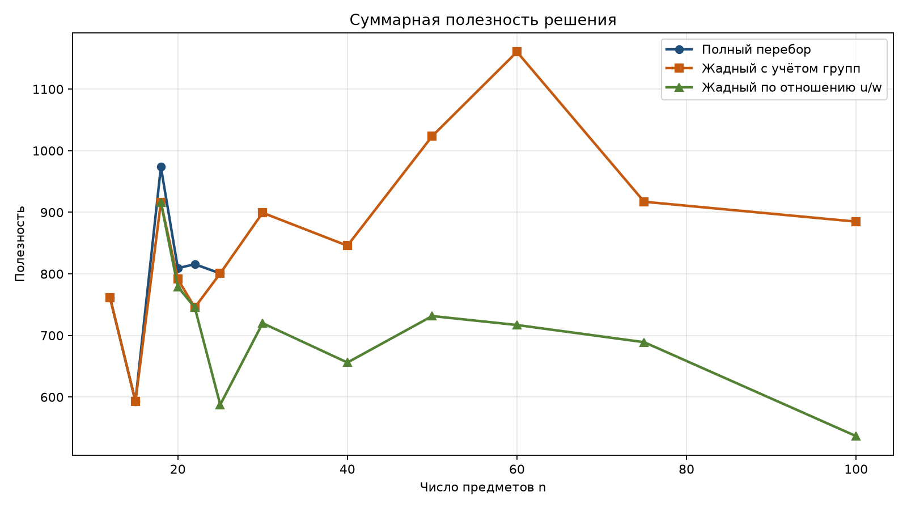
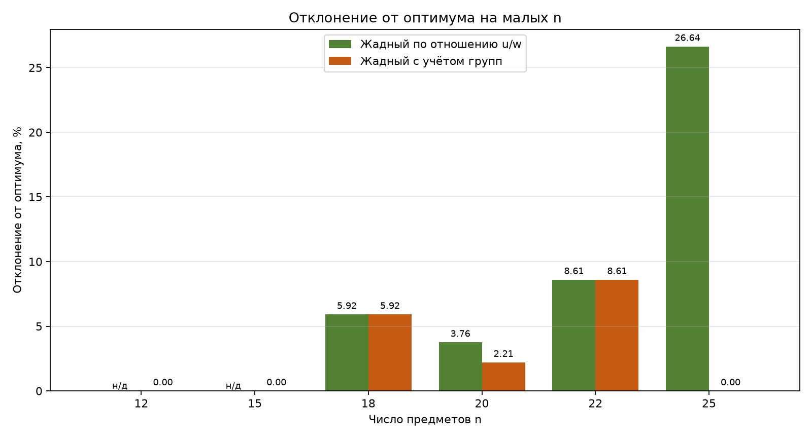
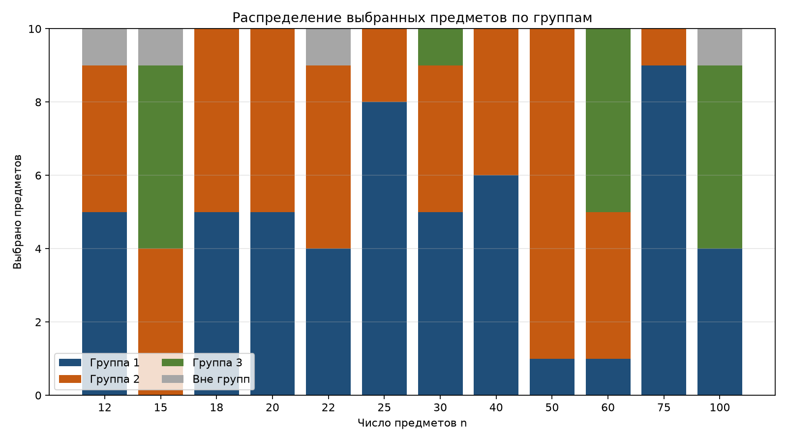
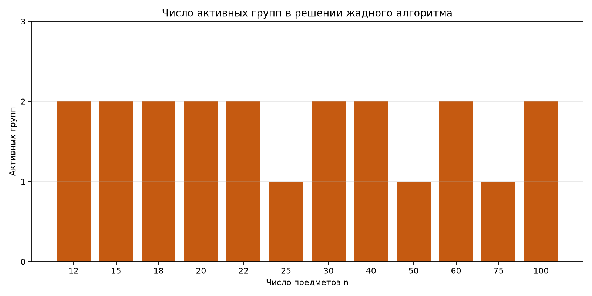
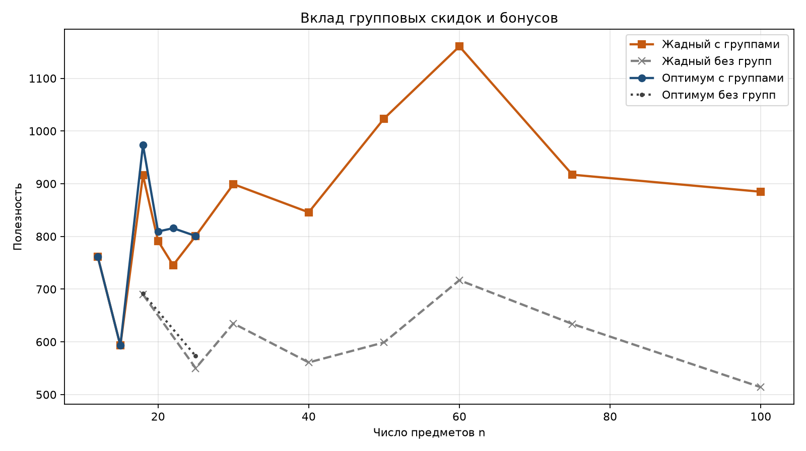
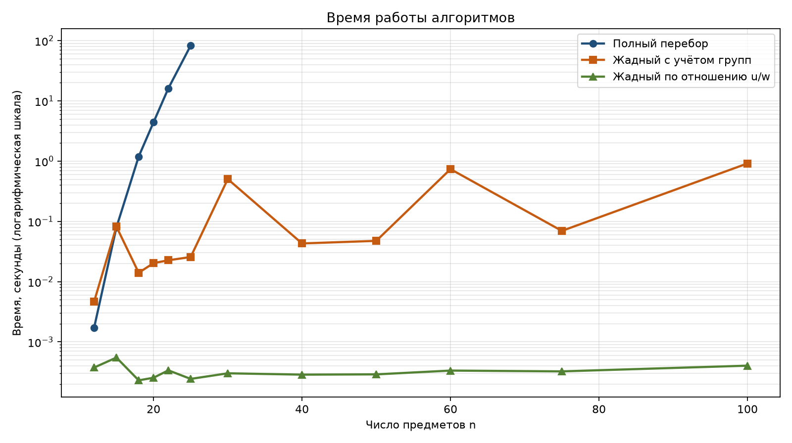

# Отчёт по экспериментам на исходном наборе

> Это отчёт по исходному набору из 12 экземпляров, по одному на каждый `n`. Расширенный эксперимент с несколькими экземплярами на размер находится в [`../report.md`](../report.md).

## 1. Цель

Сравнить точный полный перебор и жадные алгоритмы на задаче выбора ровно `Q` предметов с пороговыми групповыми скидками и бонусами. Отдельно оценивается, какой вклад дают групповые эффекты и насколько быстро методы работают при росте `n`.

## 2. Постановка

Есть один рюкзак вместимости `W_max` и `n` уникальных предметов. Нужно выбрать ровно `Q` различных предметов. Предмет может входить не более чем в одну группу. Если из группы выбрано не меньше её порога `t_k`, одновременно включаются скидка на вес `d_k` и бонус к полезности `b_k`, причём оба эффекта действуют на все выбранные предметы группы. Предметы вне групп учитываются без эффектов.

Все решения оцениваются через `evaluate_selection`, поэтому пороговые правила не дублируются в алгоритмах.

## 3. Данные

Использован зафиксированный набор из 12 экземпляров:

- `n = 12, 15, 18, 20, 22, 25, 30, 40, 50, 60, 75, 100`;
- `Q = 10`;
- 2–3 непересекающиеся группы;
- порог группы 4 или 5 предметов;
- скидка на вес 25–50%;
- бонус полезности 0–50%;
- исходные веса и полезности — целые числа 1–100;
- в каждом экземпляре есть предметы вне групп.

Для каждого экземпляра генератор заранее строит допустимое и недопустимое контрольные распределения, поэтому данные проверяются тестами на неизменность и корректность.

## 4. Методы

### 4.1. Полный перебор

Перебираются все сочетания ровно из `Q` предметов. Каждое сочетание оценивается через `evaluate_selection`; недопустимые по весу варианты отбрасываются, среди допустимых выбирается максимум полезности. Число проверяемых сочетаний равно `C(n, Q)`. Метод даёт точный оптимум, но применим только к малым `n`.

### 4.2. Жадный алгоритм по отношению полезности к весу

Базовый жадный метод: предметы сортируются по исходному отношению `u_i / w_i` и добавляются, пока набор укладывается в рюкзак. Если до `Q` предметов добрать не удалось, оставшиеся места заполняются самыми лёгкими предметами. Групповые пороги в критерии не учитываются, но проверяются через оценщик.

### 4.3. Жадный алгоритм с учётом групп

Улучшенный метод рассматривает два конструктивных правила:

1. последовательное добавление одного предмета или сразу группового пакета, который доводит группу до порога;
2. перебор распределения `Q` мест по группам и жадное заполнение каждой группы по одному из правил: отношение `u/w`, максимум полезности или минимум веса.

Каждый ход оценивается через `evaluate_selection`, поэтому активация скидки и бонуса учитывается по фактическому изменению веса и полезности. Из всех допустимых вариантов выбирается лучший по полезности.

### 4.4. Базовые решения без групповых эффектов

Для оценки вклада групп использованы два дополнительных метода: полный перебор и жадный алгоритм по исходным весам и полезностям без скидок и бонусов. Они не заменяют основную постановку, а служат точкой сравнения.

## 5. Результаты

### 5.1. Сводная таблица

Прочерк в столбце оптимума означает, что полный перебор для этого `n` не запускался. Прочерк в отклонении означает, что жадный метод не нашёл допустимого решения.

| n | Оптимум | Жадный u/w | Откл., % | Жадный с группами | Откл., % | Активные группы | Распределение |
|---:|---:|---:|---:|---:|---:|---|---|
| 12 | 761.64 | 668.10 | — | 761.64 | 0.00 | 1; 2 | 1:5, 2:4, вне:1 |
| 15 | 593.04 | 652.56 | — | 593.04 | 0.00 | 2; 3 | 1:0, 2:4, 3:5, вне:1 |
| 18 | 973.74 | 916.14 | 5.92 | 916.14 | 5.92 | 1; 2 | 1:5, 2:5, вне:0 |
| 20 | 809.36 | 778.93 | 3.76 | 791.51 | 2.21 | 1; 2 | 1:5, 2:5, вне:0 |
| 22 | 815.67 | 745.47 | 8.61 | 745.47 | 8.61 | 1; 2 | 1:4, 2:5, вне:1 |
| 25 | 800.86 | 587.51 | 26.64 | 800.86 | 0.00 | 1 | 1:8, 2:2, вне:0 |
| 30 | — | 719.96 | — | 899.26 | — | 1; 2 | 1:5, 2:4, 3:1, вне:0 |
| 40 | — | 656.04 | — | 845.79 | — | 1; 2 | 1:6, 2:4, вне:0 |
| 50 | — | 731.53 | — | 1023.67 | — | 2 | 1:1, 2:9, вне:0 |
| 60 | — | 717.00 | — | 1160.54 | — | 2; 3 | 1:1, 2:4, 3:5, вне:0 |
| 75 | — | 689.08 | — | 917.16 | — | 1 | 1:9, 2:1, вне:0 |
| 100 | — | 536.55 | — | 884.85 | — | 1; 3 | 1:4, 2:0, 3:5, вне:1 |

Для `n = 12` и `n = 15` решение базового жадного метода по отношению `u/w` недопустимо по весу; значения полезности в таблице приведены справочно и не участвуют в расчёте отклонения.



### 5.2. Точность на малых n

На шести экземплярах, где возможен полный перебор:

- жадный алгоритм с учётом групп достиг оптимума на `n = 12, 15, 25`, то есть в 3 случаях из 6;
- среднее отклонение от оптимума — **2.79%**, максимальное — **8.61%** при `n = 22`;
- жадный алгоритм по отношению `u/w` не нашёл допустимого решения при `n = 12` и `n = 15`;
- среди экземпляров, где базовый жадный метод всё же дал допустимое решение, его среднее отклонение — **11.23%**, максимальное — **26.64%** при `n = 25`.



Основная причина ошибок жадного метода с группами — выбор конкретных предметов внутри группы. Распределение по группам может совпасть с оптимальным, но при фиксированном числе мест в группе разные предметы дают разный вес и разную полезность. На `n = 22` оба жадных метода выбрали те же группы, что и оптимум, но другую пятёрку предметов, поэтому отклонение составило 8.61%.

### 5.3. Большие n

При `n = 30..100` полный перебор не запускался: уже при `n = 25` нужно проверить `C(25,10) = 3 268 760` сочетаний, а при `n = 30` — `C(30,10) = 30 045 015`. Жадный алгоритм с учётом групп нашёл допустимое решение на всех 12 экземплярах.

На больших `n` решение обычно концентрируется в одной-двух группах:

- при `n = 50` выбрано 9 предметов из группы 2;
- при `n = 60` активированы группы 2 и 3, из них выбрано 4 и 5 предметов;
- при `n = 75` выбрано 9 предметов из группы 1;
- при `n = 100` активированы группы 1 и 3, из них выбрано 4 и 5 предметов.

Все три группы одновременно не активируются ни в одном решении: при `Q = 10` и порогах 4–5 суммы трёх порогов не хватает, чтобы одновременно активировать все три группы. Это соответствует структуре данных.





### 5.4. Вклад групповых эффектов

Базовые решения без групп часто вообще не укладываются в рюкзак: при `n = 12, 15, 20, 22` не существует допустимого набора ровно из `Q` предметов по исходным весам. Групповые скидки делают такие наборы допустимыми.

Там, где решение без групп существует, групповые эффекты дают заметный прирост полезности:

| n | Жадный с группами | Жадный без групп | Прирост |
|---:|---:|---:|---:|
| 18 | 916.14 | 690.00 | +32.8% |
| 25 | 800.86 | 550.00 | +45.6% |
| 30 | 899.26 | 635.00 | +41.6% |
| 40 | 845.79 | 561.00 | +50.8% |
| 50 | 1023.67 | 599.00 | +70.9% |
| 60 | 1160.54 | 717.00 | +61.9% |
| 75 | 917.16 | 634.00 | +44.7% |
| 100 | 884.85 | 514.00 | +72.2% |

Для точного перебора на `n = 18` и `n = 25` картина та же: оптимум с группами равен 973.74 и 800.86, без групп — 692.00 и 573.00. Это подтверждает, что группы влияют не только на значение целевой функции, но и на саму допустимость решения.



### 5.5. Время работы

| n | Полный перебор, с | Жадный с группами, с | Жадный u/w, с |
|---:|---:|---:|---:|
| 12 | 0.002 | 0.005 | 0.0004 |
| 15 | 0.079 | 0.082 | 0.0005 |
| 18 | 1.19 | 0.014 | 0.0002 |
| 20 | 4.41 | 0.020 | 0.0003 |
| 22 | 16.17 | 0.023 | 0.0003 |
| 25 | 82.67 | 0.026 | 0.0002 |
| 30 | — | 0.503 | 0.0003 |
| 40 | — | 0.043 | 0.0003 |
| 50 | — | 0.048 | 0.0003 |
| 60 | — | 0.737 | 0.0003 |
| 75 | — | 0.070 | 0.0003 |
| 100 | — | 0.915 | 0.0004 |

Время полного перебора растёт вместе с `C(n,Q)`: от долей секунды при `n = 12` до 82.67 с при `n = 25`. Жадный алгоритм с учётом групп остаётся в пределах одной секунды даже при `n = 100`. Базовый жадный метод работает ещё быстрее, но часто даёт худшее качество и иногда не находит допустимого решения.



## 6. Ограничения эксперимента

1. В наборе по одному экземпляру на каждое `n`, поэтому результаты показывают поведение на конкретных данных, а не среднее по генеральной совокупности.
2. Полный перебор использован только при `n ≤ 25`; для больших `n` оптимальность жадного решения не доказана.
3. Данные синтетические: веса, полезности и параметры групп распределены случайно в заданных диапазонах.
4. Жадный алгоритм с группами использует несколько конструктивных правил, но остаётся эвристикой; его качество зависит от структуры групп и порогов.
5. Экземпляры `n = 1000` и `n = 5000` не рассматривались: текущий профиль с `Q = 10` и порогами 4–5 даёт для них очень большие группы, и такой набор требует отдельного согласования.

## 7. Выводы

1. Полный перебор подтверждает модель и даёт эталон для малых `n`, но быстро становится вычислительно тяжёлым: при `n = 25` он занимает около 83 с.
2. Жадный алгоритм по отношению `u/w` без учёта групп непригоден как основной метод: на двух из шести малых экземпляров он не нашёл допустимого решения, а на остальных уступал оптимуму в среднем на 11.23%.
3. Жадный алгоритм с учётом групп допустим на всех 12 экземплярах, достигает оптимума в 3 случаях из 6 на малых `n` и имеет среднее отклонение 2.79%. На больших `n` он работает менее одной секунды.
4. Групповые эффекты существенны: без них часть экземпляров вообще не имеет допустимого решения, а там, где решение есть, полезность возрастает на 33–72%.
5. Для тезиса достаточно схемы «точный перебор на `n = 12..25` как эталон + жадный алгоритм с учётом групп на всех `n`». Дополнительно полезно показать базовый жадный метод без групп как точку сравнения.

## 8. Воспроизведение

```bash
python -m group_discount_optimization.experiment --data data --output reports/fixed --exhaustive-max-n 25
python -m group_discount_optimization.analysis --results reports/fixed/results.csv --output reports/fixed
python -m pytest
```

Первая команда занимает около двух минут: основное время уходит на полный перебор при `n = 25`.

## 9. Файлы

- `reports/fixed/results.csv` — полные результаты по экземплярам и методам;
- `reports/fixed/summary.csv` — сводка по `n`;
- `reports/fixed/experiment_config.json` — параметры запуска;
- `reports/fixed/figures/` — графики;
- `reports/fixed/report.md` — этот отчёт.
