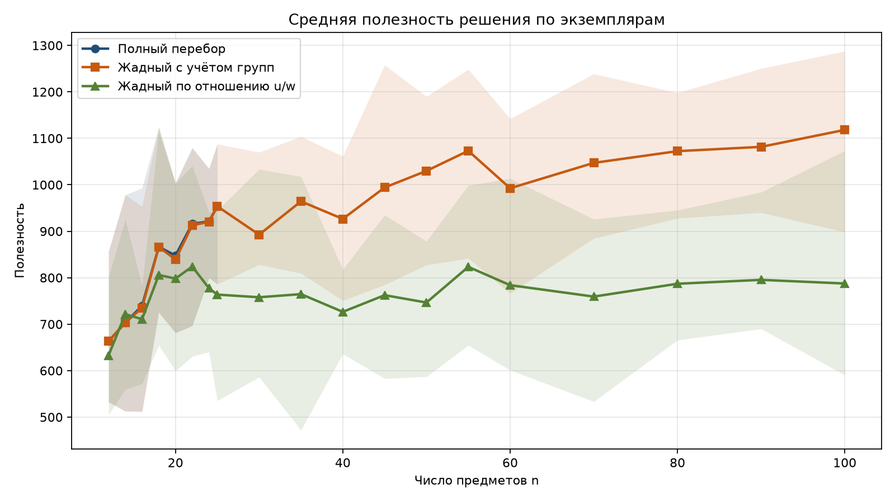
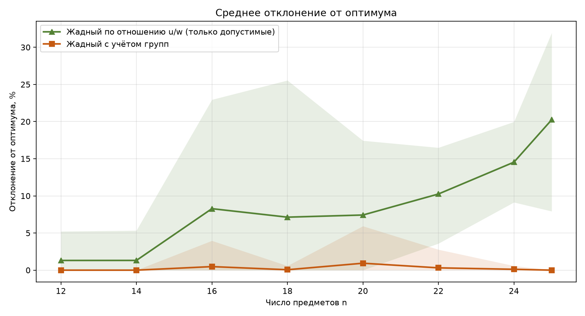
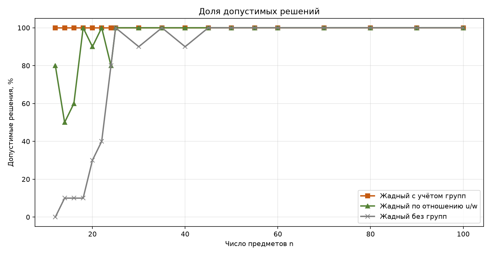
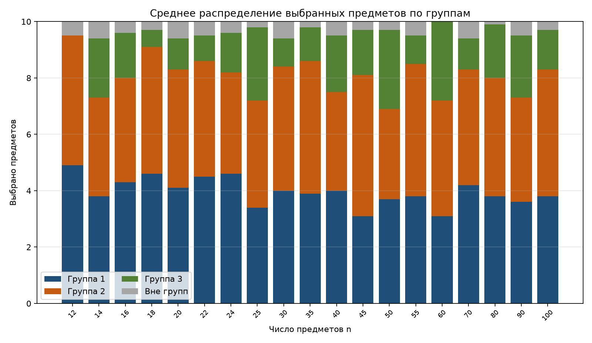
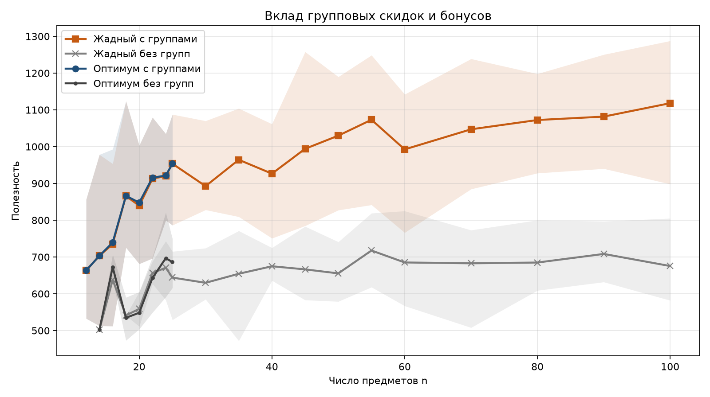
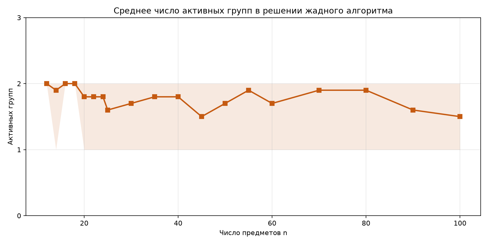
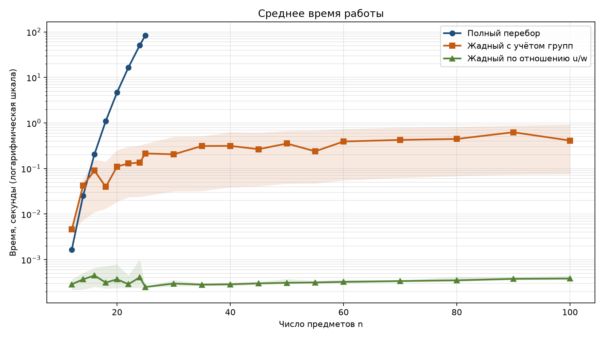

# Отчёт по расширенным экспериментам

## 1. Цель

Сравнить точный полный перебор и жадные алгоритмы на задаче выбора ровно `Q` предметов с пороговыми групповыми скидками и бонусами. В отличие от первого отчёта, здесь каждый размер `n` представлен несколькими экземплярами. Это позволяет смотреть на средние значения и разброс, а не на один случайный набор.

## 2. Постановка

Есть один рюкзак вместимости `W_max` и `n` уникальных предметов. Нужно выбрать ровно `Q` различных предметов. Предмет может входить не более чем в одну группу. Если из группы выбрано не меньше её порога `t_k`, одновременно включаются скидка на вес `d_k` и бонус к полезности `b_k`, причём оба эффекта действуют на все выбранные предметы группы. Предметы вне групп учитываются без эффектов.

Все решения оцениваются через `evaluate_selection`, поэтому пороговые правила не дублируются в алгоритмах.

## 3. Данные

Использованы 180 экземпляров для 19 значений `n` от 12 до 100:

- `data_repeated/` — по 10 экземпляров на каждый размер `n = 12, 14, 16, 18, 20, 22, 30, 35, 40, 45, 50, 55, 60, 70, 80, 90, 100`, всего 170 экземпляров;
- `data_repeated_2425/` — по 5 экземпляров на `n = 24` и `n = 25`, всего 10 экземпляров.

Для `n = 24` и `n = 25` взято по 5 экземпляров, потому что полный перебор на этих размерах занимает около 51 и 84 с на один экземпляр.

Параметры наборов:

- `Q = 10`;
- 2–3 непересекающиеся группы;
- порог группы 4 или 5 предметов;
- скидка на вес 25–50%;
- бонус полезности 0–50%;
- исходные веса и полезности — целые числа 1–100;
- в каждом экземпляре есть предметы вне групп.

Зафиксированный набор `data/` из 12 экземпляров не изменялся. Он остаётся контрольным, а расширенные прогоны лежат в отдельных каталогах.

## 4. Методы

### 4.1. Полный перебор

Перебираются все сочетания ровно из `Q` предметов. Каждое сочетание оценивается через `evaluate_selection`; недопустимые по весу варианты отбрасываются, среди допустимых выбирается максимум полезности. Число проверяемых сочетаний равно `C(n, Q)`. Метод даёт точный оптимум, но применим только к малым `n`.

### 4.2. Жадный алгоритм по отношению полезности к весу

Базовый жадный метод: предметы сортируются по исходному отношению `u_i / w_i` и добавляются, пока набор укладывается в рюкзак. Если до `Q` предметов добрать не удалось, оставшиеся места заполняются самыми лёгкими предметами. Групповые пороги в критерии не учитываются, но проверяются через оценщик.

### 4.3. Жадный алгоритм с учётом групп

Улучшенный метод рассматривает два конструктивных правила:

1. последовательное добавление одного предмета или сразу группового пакета, который доводит группу до порога;
2. перебор распределения `Q` мест по группам и жадное заполнение каждой группы по одному из правил: отношение `u/w`, максимум полезности или минимум веса.

Каждый ход оценивается через `evaluate_selection`, поэтому активация скидки и бонуса учитывается по фактическому изменению веса и полезности. Из всех допустимых вариантов выбирается лучший по полезности.

### 4.4. Базовые решения без групповых эффектов

Для оценки вклада групп использованы два дополнительных метода: полный перебор и жадный алгоритм по исходным весам и полезностям без скидок и бонусов. Они не заменяют основную постановку, а служат точкой сравнения.

## 5. Результаты

### 5.1. Сводная таблица

Прочерк в столбце оптимума означает, что полный перебор для этого `n` не запускался. Отклонение считается только там, где известен оптимум, поэтому для `n >= 30` оно не приводится.

| n | Экз. | Оптимум | Жадный с группами, откл. среднее | Жадный с группами, откл. максимум | Жадный u/w, допустимых | Жадный u/w, откл. среднее | Жадный u/w, откл. максимум | Перебор, с | Жадный с группами, с |
|---:|---:|---:|---:|---:|---:|---:|---:|---:|---:|
| 12 | 10 | 663.36 | 0.00 | 0.00 | 8/10 | 1.31 | 5.22 | 0.002 | 0.005 |
| 14 | 10 | 703.21 | 0.00 | 0.00 | 5/10 | 1.31 | 5.34 | 0.025 | 0.042 |
| 16 | 10 | 739.40 | 0.48 | 3.96 | 6/10 | 8.28 | 22.95 | 0.205 | 0.090 |
| 18 | 10 | 866.38 | 0.06 | 0.58 | 10/10 | 7.13 | 25.55 | 1.101 | 0.040 |
| 20 | 10 | 847.79 | 0.94 | 5.93 | 9/10 | 7.42 | 17.44 | 4.707 | 0.110 |
| 22 | 10 | 915.80 | 0.31 | 2.77 | 10/10 | 10.25 | 16.49 | 16.514 | 0.129 |
| 24 | 5 | 921.24 | 0.12 | 0.59 | 4/5 | 14.53 | 19.97 | 50.694 | 0.135 |
| 25 | 5 | 953.63 | 0.00 | 0.00 | 5/5 | 20.25 | 31.93 | 84.063 | 0.215 |
| 30 | 10 | — | — | — | 10/10 | — | — | — | 0.205 |
| 35 | 10 | — | — | — | 10/10 | — | — | — | 0.312 |
| 40 | 10 | — | — | — | 10/10 | — | — | — | 0.314 |
| 45 | 10 | — | — | — | 10/10 | — | — | — | 0.266 |
| 50 | 10 | — | — | — | 10/10 | — | — | — | 0.354 |
| 55 | 10 | — | — | — | 10/10 | — | — | — | 0.239 |
| 60 | 10 | — | — | — | 10/10 | — | — | — | 0.392 |
| 70 | 10 | — | — | — | 10/10 | — | — | — | 0.425 |
| 80 | 10 | — | — | — | 10/10 | — | — | — | 0.445 |
| 90 | 10 | — | — | — | 10/10 | — | — | — | 0.626 |
| 100 | 10 | — | — | — | 10/10 | — | — | — | 0.411 |



### 5.2. Точность на малых n

На 70 экземплярах, где возможен полный перебор (`n = 12..25`):

- жадный алгоритм с учётом групп достиг оптимума в 61 случае из 70;
- среднее отклонение от оптимума — **0.26%**, максимальное — **5.93%** при `n = 20`;
- в 65 случаях из 70 отклонение не превысило 1%;
- жадный алгоритм по отношению `u/w` был допустим в 57 случаях из 70, то есть в **81.4%**;
- среди допустимых решений базового метода среднее отклонение — **8.19%**, максимальное — **31.93%** при `n = 25`;
- доля допустимых решений у базового метода падает до 50–60% при `n = 14..16`, где пороги групп заметно влияют на вес набора.



Основная причина ошибок жадного метода с группами — выбор конкретных предметов внутри группы. Распределение по группам может совпасть с оптимальным, но при фиксированном числе мест в группе разные предметы дают разный вес и разную полезность. Поэтому даже при верной структуре решения отклонение может достигать нескольких процентов.

### 5.3. Допустимость и большие n

Жадный алгоритм с учётом групп нашёл допустимое решение на всех 180 экземплярах. Базовый жадный метод по отношению `u/w` был допустим на 167 экземплярах из 180, то есть в **92.8%** случаев. На больших `n`, начиная с 30, он был допустим на всех экземплярах, а основные потери допустимости приходятся на малые размеры.

Решение без групповых эффектов оказалось допустимым только на 127 экземплярах из 180, то есть в **70.6%** случаев. Иными словами, почти в трети экземпляров набор ровно из `Q` предметов по исходным весам просто не помещается в рюкзак.

При `Q = 10` и порогах 4–5 все три группы одновременно не активируются: среднее число активных групп составляет 1.5–2. Решение обычно концентрируется в одной или двух группах, а оставшиеся места занимают предметы вне групп.





### 5.4. Вклад групповых эффектов

Без скидок и бонусов 53 экземпляра из 180 не имеют допустимого решения. Там, где решение без групп всё же существует, групповые эффекты дают заметный прирост полезности:

- средний прирост — **49.0%**;
- минимальный — **10.2%**;
- максимальный — **105.3%**.

Это подтверждает, что группы влияют не только на значение целевой функции, но и на саму допустимость решения. Поэтому вариант без групп нельзя использовать как основной метод даже при больших `n`.





### 5.5. Время работы

Полный перебор растёт вместе с `C(n, Q)`: от 0.002 с при `n = 12` до 16.5 с при `n = 22`, 50.7 с при `n = 24` и 84.1 с при `n = 25`. При `n = 25` проверяется `C(25,10) = 3 268 760` сочетаний, при `n = 30` было бы уже `C(30,10) = 30 045 015`, поэтому дальше перебор не запускался.

Жадный алгоритм с учётом групп работает от 0.005 с при `n = 12` до 0.41 с в среднем при `n = 100`. Максимальное время на одном экземпляре — 0.91 с. Базовый жадный метод по отношению `u/w` работает примерно за 0.0003 с, но часто даёт худшее качество и иногда не находит допустимого решения.



## 6. Ограничения эксперимента

1. Данные синтетические: веса, полезности и параметры групп распределены случайно в заданных диапазонах.
2. Для `n = 24` и `n = 25` взято по 5 экземпляров, поэтому разброс на этих размерах оценён грубее.
3. Полный перебор использован только при `n <= 25`; для больших `n` оптимальность жадного решения не доказана.
4. Жадный алгоритм с группами остаётся эвристикой: он проверяет несколько конструктивных правил, но не перебирает все допустимые составы.
5. Экземпляры `n = 1000` и `n = 5000` не рассматривались: текущий профиль с `Q = 10` и порогами 4–5 даёт для них очень большие группы, и такой набор требует отдельного согласования.

## 7. Выводы

1. Полный перебор подтверждает модель и даёт эталон для малых `n`, но быстро становится вычислительно тяжёлым: при `n = 25` он занимает около 84 с.
2. Жадный алгоритм по отношению `u/w` без учёта групп непригоден как основной метод: на малых `n` он допустим только в 81.4% случаев, а среди допустимых решений уступает оптимуму в среднем на 8.19%.
3. Жадный алгоритм с учётом групп допустим на всех 180 экземплярах, достигает оптимума в 61 случае из 70 на малых `n` и имеет среднее отклонение 0.26%. На больших `n` он работает менее одной секунды.
4. Групповые эффекты существенны: без них 29.4% экземпляров вообще не имеют допустимого решения, а там, где решение есть, полезность возрастает в среднем на 49%.
5. Для тезиса достаточно схемы "точный перебор на `n = 12..25` как эталон плюс жадный алгоритм с учётом групп на всех `n`". Базовый жадный метод и решение без групп полезны как точки сравнения.

## 8. Воспроизведение

```bash
python -m group_discount_optimization.experiment --data data_repeated --output reports/repeated_main --exhaustive-max-n 22
python -m group_discount_optimization.experiment --data data_repeated_2425 --output reports/repeated_2425 --exhaustive-max-n 25
python -m group_discount_optimization.analysis --results reports/repeated_main/results.csv reports/repeated_2425/results.csv --output reports --merge-output reports/results.csv
python -m pytest
```

Первый прогон занимает несколько минут, второй — около 12 минут: основное время уходит на полный перебор при `n = 24` и `n = 25`.

## 9. Файлы

- `reports/results.csv` — объединённые результаты по 180 экземплярам и всем методам;
- `reports/summary.csv` — сводка по `n`;
- `reports/figures/` — графики;
- `reports/repeated_main/` — прогон по `data_repeated` с собственным `experiment_config.json`;
- `reports/repeated_2425/` — прогон по `data_repeated_2425`;
- `reports/fixed/` — первый отчёт по одному экземпляру на каждый `n`;
- `reports/report.md` — этот отчёт.
